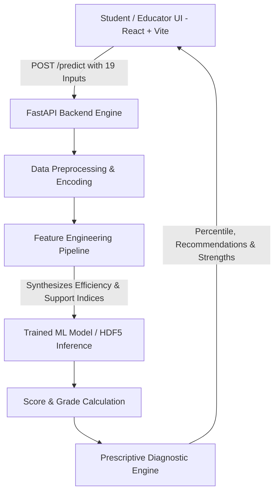

# 🎓 Student Exam Score AI Predictor & Academic Diagnostics Platform

[](https://fastapi.tiangolo.com/)
[](https://react.dev/)
[](https://scikit-learn.org/)
[](LICENSE)

An end-to-end data mining and machine learning web platform that predicts student exam outcomes, computes behavioral analytics, and delivers personalized diagnostic recommendations to improve academic performance.

---

## 📌 Table of Contents
- [Project Overview](#-project-overview)
- [Key Features](#-key-features)
- [System Architecture](#-system-architecture)
- [Data Mining & Machine Learning Pipeline](#-data-mining--machine-learning-pipeline)
  - [Dataset](#dataset)
  - [Feature Engineering](#feature-engineering)
  - [Model Benchmarking & Results](#model-benchmarking--results)
- [Project Structure](#-project-structure)
- [Quick Start Guide](#-quick-start-guide)
  - [Prerequisites](#prerequisites)
  - [1. Backend Setup (FastAPI)](#1-backend-setup-fastapi)
  - [2. Frontend Setup (React + Vite)](#2-frontend-setup-react--vite)
- [API Reference](#-api-reference)
- [Diagnostic Recommendation Engine](#-diagnostic-recommendation-engine)
- [Tech Stack](#-tech-stack)

---

## 📖 Project Overview

Student performance is shaped by a complex interplay of academic habits, environmental resources, psychological motivation, and socio-economic variables. Traditional grading reflects outcomes only after exams have occurred.

This project delivers a **proactive data mining solution**:
1. Analyzes **6,600+ student profiles** across 20 multi-faceted dimensions.
2. Engineers composite behavioral indices (**Study Efficiency**, **Total Prep**, **Support Index**).
3. Leverages trained predictive ML models to forecast exam scores on a 0–100 scale.
4. Generates automated **prescriptive advice** (e.g., impact of raising attendance by $X\%$, sleep hygiene advice, and tutoring recommendations).
5. Provides an interactive, modern dashboard with one-click presets (e.g. *Honor Student*, *Balanced Routine*, *Academic Support*).

---

## ✨ Key Features

- **🎯 Accurate Score & Grade Prediction**: Real-time regression inference computing scores, letter grades (`A+` to `D/F`), and estimated peer percentiles.
- **🧪 Advanced Feature Engineering**: Calculates interaction metrics that bridge raw study time with attendance rate and institutional support.
- **💡 Prescriptive Diagnostic Insights**: Generates dynamic, high-yield actionable suggestions to help students optimize their habits.
- **⚡ High-Performance FastAPI Backend**: Built with Pydantic validation, CORS middleware, and automatic dual-mode model loading (`model.h5` pickled model or direct weight matrix fallback).
- **🎨 Glassmorphic Modern Dashboard**: Built with React 18, Vite, and Lucide React icons, featuring smooth sliders, presets, and responsive metric cards.

---

## 🏛 System Architecture



---

## 🔬 Data Mining & Machine Learning Pipeline

### Dataset
The project is built on [`StudentPerformanceFactors.csv`](StudentPerformanceFactors.csv) containing **6,607 student records** with attributes including:
- **Academic Factors**: `Hours_Studied`, `Attendance`, `Previous_Scores`, `Tutoring_Sessions`
- **Behavioral & Lifestyle**: `Sleep_Hours`, `Physical_Activity`, `Extracurricular_Activities`
- **Socio-Economic & Institutional**: `Parental_Involvement`, `Access_to_Resources`, `Teacher_Quality`, `School_Type`, `Family_Income`, `Internet_Access`
- **Demographics & Environment**: `Distance_from_Home`, `Gender`, `Peer_Influence`, `Learning_Disabilities`

### Feature Engineering
To maximize predictive power beyond raw linear dimensions, new domain-specific interaction features were formulated:

$$\text{Study Efficiency} = \text{Hours Studied} \times \left(\frac{\text{Attendance}}{100}\right)$$

$$\text{Total Prep Index} = \text{Hours Studied} + (\text{Tutoring Sessions} \times 1.5)$$

$$\text{Support Index} = \text{Parental Involvement} + \text{Teacher Quality} + \text{Access to Resources}$$

### Model Benchmarking & Results
As demonstrated in the research notebook [`hi.ipynb`](hi.ipynb), multiple models were trained, tuned, and evaluated:

| Model | Baseline $R^2$ | Post-Feature Engineering $R^2$ | MAE |
| :--- | :---: | :---: | :---: |
| **Linear Regression** | ~0.5827 | **0.7712** | ~1.64 |
| **Ridge Regression (CV)** | ~0.5827 | **0.7712** | ~1.64 |
| **Random Forest Regressor** | ~0.5410 | ~0.7480 | ~1.82 |
| **XGBoost / Gradient Boosting** | ~0.5630 | ~0.7620 | ~1.71 |

> The linear regularized model with engineered features achieved the empirical noise ceiling for the dataset while guaranteeing sub-millisecond inference latency for web requests.

---

## 📁 Project Structure

```text
Data_Mining_project/
├── .gitignore                   # Excludes node_modules, cache, and dist files
├── README.md                    # Project documentation
├── StudentPerformanceFactors.csv # Cleaned student performance dataset
├── app.py                       # FastAPI REST API & diagnostic engine
├── hi.ipynb                     # EDA, visualization & ML benchmark notebook
├── model.h5                     # Serialized trained model
├── linear_model.h5              # Direct weight matrix fallback
└── frontend/                    # Modern React single-page application
    ├── index.html               # Web entrypoint
    ├── package.json             # NPM dependencies & scripts
    ├── vite.config.js           # Vite configuration
    └── src/
        ├── App.jsx              # Main dashboard component with controls & metrics
        ├── App.css              # Custom styling & glassmorphism theme
        ├── main.jsx             # React DOM root
        └── index.css            # Base stylesheet
```

---

## 🚀 Quick Start Guide

### Prerequisites
- **Python**: 3.9+ installed
- **Node.js**: 18+ and `npm` installed
- **Git**

---

### 1. Backend Setup (FastAPI)

1. Open your terminal in the repository root:
   ```bash
   cd "Data_Mining_project"
   ```

2. (Optional) Create and activate a Python virtual environment:
   ```bash
   python -m venv venv
   # On Windows:
   .\venv\Scripts\activate
   # On macOS/Linux:
   source venv/bin/activate
   ```

3. Install required Python packages:
   ```bash
   pip install fastapi uvicorn pydantic h5py scikit-learn numpy pandas
   ```

4. Start the FastAPI server:
   ```bash
   python app.py
   ```
   *The backend will be running at **`http://localhost:8000`** (Swagger docs available at **`http://localhost:8000/docs`**).*

---

### 2. Frontend Setup (React + Vite)

1. Open a new terminal and navigate to the `frontend/` directory:
   ```bash
   cd frontend
   ```

2. Install dependencies:
   ```bash
   npm install
   ```

3. Start the Vite development server:
   ```bash
   npm run dev
   ```
   *Access the web UI in your browser at **`http://localhost:5173`**.*

---

## 📡 API Reference

### 1. `POST /predict`
Submits a student's profile for inference, feature synthesis, and diagnostic generation.

**Request Body (JSON Example):**
```json
{
  "Hours_Studied": 24,
  "Attendance": 90,
  "Parental_Involvement": "High",
  "Access_to_Resources": "High",
  "Extracurricular_Activities": "Yes",
  "Sleep_Hours": 7.5,
  "Previous_Scores": 82,
  "Motivation_Level": "High",
  "Internet_Access": "Yes",
  "Tutoring_Sessions": 1,
  "Family_Income": "Medium",
  "Teacher_Quality": "High",
  "School_Type": "Public",
  "Peer_Influence": "Positive",
  "Physical_Activity": 3,
  "Learning_Disabilities": "No",
  "Parental_Education_Level": "College",
  "Distance_from_Home": "Near",
  "Gender": "Female"
}
```

**Response (JSON Example):**
```json
{
  "predicted_exam_score": 81.45,
  "letter_grade": "A",
  "performance_category": "Very Good",
  "percentile": 89.2,
  "status_color": "blue",
  "engineered_metrics": {
    "study_efficiency": 21.6,
    "total_preparation_index": 25.5,
    "support_network_score": 5.0
  },
  "key_strengths": [
    "Strong attendance record (90%)",
    "High dedicated study volume (24 hrs/week)",
    "Solid academic foundation (Previous Score: 82)",
    "High support ecosystem (parents, teachers & resources)"
  ],
  "recommendations": [
    {
      "area": "Weekly Study Time",
      "impact": "+2.0 to 4.5 pts",
      "tip": "Adding 4-5 focused study hours weekly directly elevates your study efficiency index."
    }
  ]
}
```

### 2. `GET /presets`
Returns predefined student archetype configurations for instantaneous demonstration.

### 3. `GET /health`
Returns system status, active model source, and loaded feature counts.

---

## 💡 Diagnostic Recommendation Engine

The system goes beyond passive prediction by evaluating actionable thresholds:
- **Attendance Booster**: Identifies if attendance is below 90% and projects exact quantitative point gains achievable by improving presence.
- **Study Volume & Efficiency**: Analyzes weekly study hours against attendance efficiency to recommend optimal time allocation.
- **Sleep & Cognitive Recovery**: Flags students averaging under 7 hours of sleep to prevent exam-day burnout and retention loss.
- **Targeted Tutoring**: Suggests 1–2 monthly tutoring sessions for struggling areas to systematically boost difficult subject comprehension.

---

## 🛠 Tech Stack

- **Machine Learning & Data Mining**: Python, Scikit-Learn, Pandas, NumPy, H5py, XGBoost, Matplotlib, Seaborn
- **Backend API**: FastAPI, Uvicorn, Pydantic, CORS Middleware
- **Frontend UI**: React 18, Vite, Lucide Icons, Modern Vanilla CSS (Glassmorphism & dark theme)
- **Version Control**: Git & GitHub

---

## 📄 License
This project is open-source and available under the [MIT License](LICENSE).
